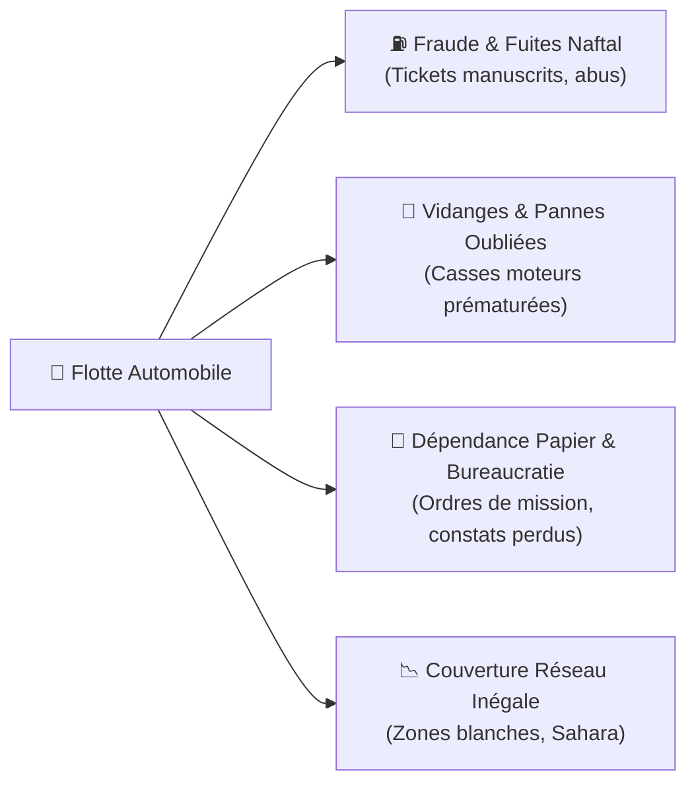
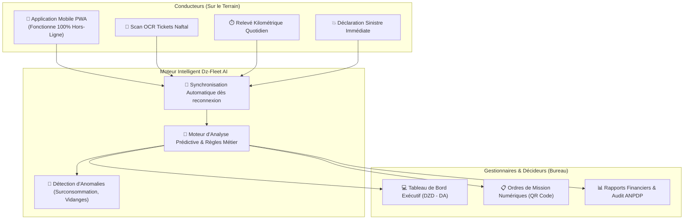
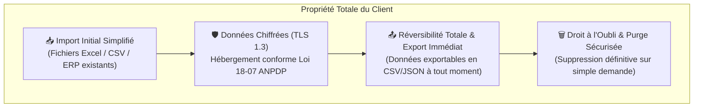
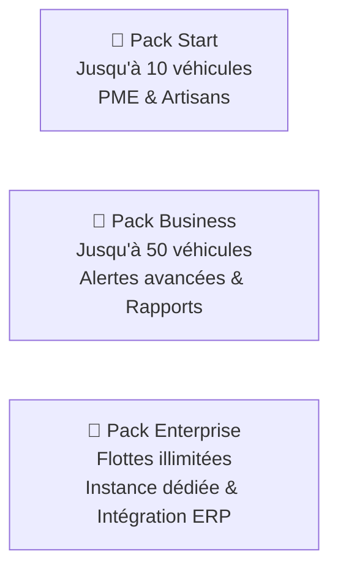

# 🇩🇿 Dz-Fleet AI — Dossier de Présentation Commerciale

> **La Première Plateforme Intelligente & Souveraine de Gestion de Flotte Automobile en Algérie**  
> *Optimisation des coûts carburant Naftal • Maintenance prédictive • PWA chauffeur 100% hors-ligne • Conformité stricte Loi 18-07 ANPDP*

---

## 📌 Sommaire Exécutif

1. [La Problématique du Marché Algérien](#1-la-problématique-du-marché-algérien)
2. [La Solution Dz-Fleet AI](#2-la-solution-dz-fleet-ai)
3. [Les 5 Piliers d'Excellence Opérationnelle](#3-les-5-piliers-dexcellence-opérationnelle)
4. [Le R.O.I. Chiffré : Pourquoi Investir Maintenant ?](#4-le-roi-chiffré--pourquoi-investir-maintenant-)
5. [Souveraineté, Intégration & Réversibilité des Données](#5-souveraineté-intégration--réversibilité-des-données)
6. [Modèle Économique & Grille Tarifaire SaaS](#6-modèle-économique--grille-tarifaire-saas)
7. [Offre Exclusive de Lancement (5 Premiers Clients Pilotes)](#7-offre-exclusive-de-lancement-5-premiers-clients-pilotes)
8. [Déploiement en 72 Heures : Méthodologie d'Implémentation](#8-déploiement-en-72-heures--méthodologie-dimplémentation)
9. [Fiche Contact & Étape Suivante](#9-fiche-contact--étape-suivante)

---

## 1. La Problématique du Marché Algérien

Gérer un parc de véhicules en Algérie (PME, ETI ou grandes entreprises publiques/privées) génère des coûts cachés colossaux et des frictions administratives quotidiennes :

* **Dérive des budgets carburant** : Rapprochement difficile entre les tickets Naftal, les cartes carburant et les kilométrages réels. Les entreprises constatent en moyenne 8% à 15% de pertes ou surconsommations inexpliquées.
* **Maintenance subie plutôt que préventive** : Les vidanges dépassées et les pneumatiques dégradés entraînent des pannes immobilisantes et réduisent drastiquement la valeur résiduelle du véhicule.
* **Processus manuels et chronophages** : Les gestionnaires de flotte passent plus de 5 heures par semaine à classer des feuilles de route papier et à courir après les justificatifs.
* **Risques légaux (Loi 18-07)** : L'utilisation de serveurs cloud étrangers sans autorisation de l'ANPDP expose l'entreprise à des sanctions réglementaires sévères sur les données de géolocalisation et de personnel.

---

## 2. La Solution Dz-Fleet AI

**Dz-Fleet AI** transforme la gestion de votre flotte en un centre d'économies automatisé grâce à une plateforme logicielle souveraine de nouvelle génération.

> [!NOTE]
> **Pourquoi Dz-Fleet AI est unique en Algérie ?**
> C'est la seule solution conçue nativement pour les spécificités du terrain algérien : prix officiels Naftal en Dinars Algériens (DA), découpage par wilayas, Ordres de Mission conformes au droit national, mode déconnecté pour le Grand Sud et hébergement souverain conforme ANPDP.

---

## 3. Les 5 Piliers d'Excellence Opérationnelle

### Pilier 1 : Suivi Carburant Naftal & Éradication des Fraudes
* Enregistrement en direct des pleins (Gasoil, Sans Plomb, Sirghaz/GPL).
* Contrôle automatique de cohérence : calcul du ratio L/100 km par rapport aux normes constructeur.
* Détection immédiate des pleins suspects ou des doublons de tickets.

### Pilier 2 : Maintenance Prédictive & Longévité du Parc
* Compte à rebours automatique avant la prochaine vidange ou révision technique.
* Alerte d'usure des pneumatiques et rappel d'expiration du contrôle technique périodique.
* Historique technique exhaustif valorisant les véhicules lors de la revente.

### Pilier 3 : Ordres de Mission Réglementaires Dématérialisés
* Génération en un clic des Ordres de Mission légaux avec matricule, chauffeur, wilaya de destination et date de validité.
* Signature et horodatage numérique pour contrôle routier facilité.
* Suppression totale du papier et archivage centralisé infalsifiable.

### Pilier 4 : Application Chauffeur PWA Offline-First
* Aucune installation complexe depuis un store : accessible directement via navigateur sur tout smartphone Android/iOS.
* **Fonctionne sans réseau internet** : le chauffeur saisit son kilométrage et ses pleins même dans les zones désertiques ou les sous-sols.
* Synchronisation en arrière-plan dès la détection d'une connexion 3G/4G/Wi-Fi.

### Pilier 5 : Sécurité & Gouvernance Souveraine (Loi 18-07)
* Architecture RBAC multi-rôles étanche (Super Administrateur, Gestionnaire Flotte, Responsable Maintenance, Contrôleur de Gestion, Chauffeur).
* Authentification forte A2F par email pour chaque opération critique.
* Journal d'audit complet retraçant chaque action avec horodatage et adresse IP.

---

## 4. Le R.O.I. Chiffré : Pourquoi Investir Maintenant ?

Chaque mois sans système de gestion représente une perte directe de trésorerie pour votre entreprise. Voici le retour sur investissement tangible constaté dès le premier trimestre :

| Problématique Actuelle | Solution Dz-Fleet AI | Gain Mesurable pour l'Entreprise |
| :--- | :--- | :--- |
| **Suivi Carburant** Tickets égarés, fraudes, surconsommation | Saisie instantanée sur le terrain via PWA + contrôle de cohérence | **-10% à -15% de fraude et de gaspillage carburant** |
| **Maintenance & Pannes** Oubli de vidange, casse moteur, usure anormale | Alertes automatisées prédictives (vidanges, filtres, freins, pneus) | **+25% de longévité des véhicules** et réduction drastique des immobilisations |
| **Gestion des Sinistres** Constats incomplets, déclarations tardives | Déclaration immédiate avec photos horodatées et export assureur | **Division par 2 des délais de prise en charge assurance (CAAT/SAA/etc.)** |
| **Saisie Administrative** Bordereaux papier, tableurs Excel disparates | Dématérialisation zéro papier, archivage légal centralisé | **Gain de 5 heures par semaine et par gestionnaire** |

> [!IMPORTANT]
> **Exemple concret pour une flotte de 30 véhicules :**
> - Dépense moyenne carburant : ~240 000 DA / mois.
> - **Économie de 10% sur le carburant** : **+24 000 DA économisés / mois**.
> - **Économie sur les pannes évitées** (1 casse moteur évitée par an) : **~350 000 DA**.
> - **Gain de temps gestionnaire** (20h/mois valorisées) : **~40 000 DA**.
> 👉 **Bénéfice net annuel estimé : +600 000 DA à 900 000 DA**, soit un investissement rentabilisé dès le premier mois !

---

## 5. Souveraineté, Intégration & Réversibilité des Données

La confiance et la sécurité juridique de nos clients sont au cœur de notre engagement.

### Nos Engagements Contractuels :
1. **Propriété exclusive de vos données** : Toutes les données enregistrées (véhicules, chauffeurs, trajets, dépenses, factures Naftal) restent la propriété exclusive de votre entreprise.
2. **Aucun enfermement propriétaire (Zéro Vendor Lock-in)** :
   - Vous importez vos données existantes dès le jour 1 sans perte d'historique.
   - En cas d'arrêt de la collaboration, vous pouvez exporter l'intégralité de vos bases de données en un clic (formats ouverts CSV, Excel, JSON).
   - Vos données sont ensuite totalement et définitivement purgées de nos serveurs sous certificat de destruction.
3. **Conformité stricte Loi 18-07 / ANPDP** :
   - Traitement des données à caractère personnel (nom des chauffeurs, numéros de permis, relevés de géolocalisation) déclaré et auditable.
   - Hébergement sur infrastructure souveraine située sur le territoire national.

---

## 6. Modèle Économique & Grille Tarifaire SaaS

Le modèle SaaS (Logiciel par abonnement) garantit une prévisibilité budgétaire totale, sans investissement lourd en matériel ni frais de licence initiale exorbitants.

### A. Abonnements Logiciel par Véhicule

* **Pack Start (1 à 10 véhicules)** :
  * Idéal pour les PME et structures en démarrage.
  * Accès complet : Suivi carburant Naftal, odomètre, PWA chauffeur, alertes de base.
* **Pack Business (11 à 50 véhicules)** :
  * Conçu pour les entreprises en pleine expansion logistique.
  * Inclus : Alertes prédictives de maintenance, gestion avancée des sinistres, rapports analytiques d'émissions CO₂ et consommation par chauffeur.
* **Pack Enterprise (Plus de 50 véhicules / Grands Comptes)** :
  * Pour les flottes industrielles, de transport ou de distribution.
  * Inclus : Déploiement sur instance souveraine dédiée, connecteurs API vers ERP / progiciels de comptabilité (SAP, Odoo, Sage, etc.), SLA garanti.

---

### B. Frais d'Implémentation & Mise en Service (One-Time Fee)
* **Configuration initiale de l'instance** : paramétrage de la charte de l'entreprise, des wilayas de circulation et des types de véhicules.
* **Reprise des données historiques** : import et nettoyage de vos fichiers Excel actuels (parc, chauffeurs, historique de maintenance).
* **Formation des équipes** : session dédiée pour les gestionnaires de flotte et guide d'adoption rapide pour les chauffeurs (30 minutes suffisent grâce à l'ergonomie PWA).

---

### C. Services à Valeur Ajoutée (Optionnels)
* **Support technique dédié prioritaire (24/7)** avec gestionnaire de compte attitré.
* **Rapports d'analyse exécutifs mensuels personnalisés** préparés par nos experts et expédiés automatiquement à la Direction Générale.
* **Personnalisation d'états de sortie réglementaires spécifiques** selon les exigences de votre secteur (hydrocarbures, BTP, agroalimentaire).

---

## 7. Offre Exclusive de Lancement (5 Premiers Clients Pilotes)

Pour célébrer le lancement commercial de la plateforme et accompagner nos partenaires stratégiques, nous réservons des conditions exceptionnelles aux **5 premières entreprises pilotes** :

| Segment de Flotte | Tarif de Lancement (Abonnement Mensuel) | Frais d'Activation & Mise en Service | Avantage Exclusif Inclus |
| :--- | :---: | :---: | :--- |
| **PME** *(Jusqu'à 20 véhicules)* | **20 000 DA** *(Forfait unique tout compris)* | ~~45 000 DA~~ **OFFERT** | Import initial des données offert + support prioritaire |
| **Grandes Flottes** *(20 à 100+ véhicules)* | **800 DA** */ véhicule / mois* | ~~90 000 DA~~ **OFFERT** | Formation sur site offerte + personnalisation des rapports |

> [!TIP]
> **Garantie Satisfait ou Remboursé sous 30 jours** : Testez la solution en conditions réelles sur vos véhicules. Si vous ne constatez pas de gain de productivité immédiat, vous êtes remboursé sans aucune condition.

---

## 8. Déploiement en 72 Heures : Méthodologie d'Implémentation

Un processus rapide, fluide et sans interruption d'activité pour vos équipes de terrain :

| Jour | Phase | Livrables & Actions |
| :---: | :--- | :--- |
| **J+1** | **Cadrage & Import** | Réception de votre listing véhicules/chauffeurs (Excel) et injection sécurisée dans votre instance Dz-Fleet AI. |
| **J+2** | **Paramétrage & Tests** | Activation des accès par rôle (A2F par email), configuration des seuils d'alertes vidanges et carburant. |
| **J+3** | **Lancement Opérationnel** | Prise en main des chauffeurs via l'URL PWA (sans rien installer). La flotte est 100% opérationnelle et sous contrôle. |

---

## 9. Fiche Contact & Étape Suivante

Prêt à reprendre le contrôle total de vos coûts de flotte et à éliminer les gaspillages ?

* 🌐 **Démonstration en ligne interactive** : Disponible sur demande en 15 minutes.
* 📧 **Contact Commercial** : `contact@fleet-dz.com` / `commercial@fleet-dz.com`
* 🏢 **Siège & Datacenter** : Alger, Algérie
* ⚖️ **Agrément & Conformité** : Respect strict du cadre légal algérien Loi 18-07 / ANPDP.

---
*Dz-Fleet AI — L'Intelligence Artificielle et la Souveraineté Numérique au service de la Mobilité Algérienne.*
